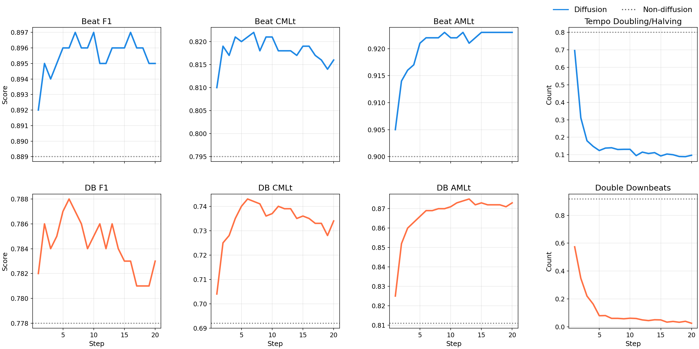
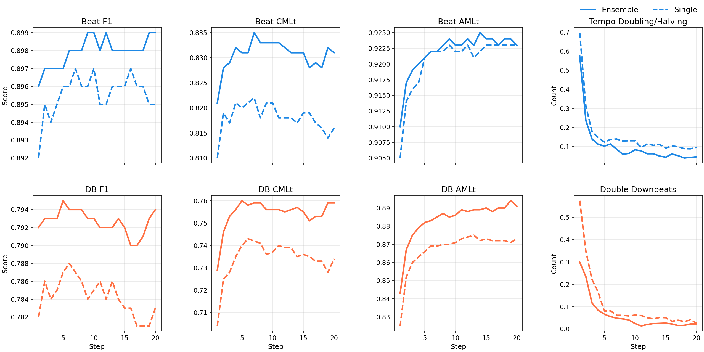

# Masked Diffusion Enables Coherent Beat Tracking

Supporting material for the ISMIR 2026 paper, [available on arXiv](https://arxiv.org/abs/2608.04624)

> F. Foscarin, F. Korzeniowski, and R. Vogl, "Masked Diffusion Enables Coherent Beat Tracking," in *Proceedings of the 27th International Society for Music Information Retrieval Conference (ISMIR)*, 2026.

This repository provides **8-fold cross-validation** metrics (not in the paper), plus an **expanded version of Figure 4** in the paper, and the **GTZAN metrics**.

We release:
- all our predictions (GTZAN as test set, and all other datasets in the CV settings), so they can be explored, and the metrics can be recomputed.
- all the activation functions (the output of both beat and downbeat heads) from the last masked diffusion step. Note that we can not simply obtain the predictions by postprocessing the activations, since the predictions are built iteratively during all the inference steps, as explained in the paper. In any case predictions and activation should roughtly correspond.

* [Layout](#layout)
* [Metrics reproducibility](#metrics-reproducibility)
* [Cross-validation results](#cross-validation-results)
* [GTZAN results](#gtzan-results)
* [Step study](#step-study)
* [Citation](#citation)

## Layout

Cross-validation datasets (**single model** per track: the fold that held the track out):

```
datasets/<dataset>/
  predictions/   # *.beats.txt  (time [s], beat_type) with 1 = downbeat, 0 = beat
  activations/   # *.npy        float32 array of shape (2, T); row 0 = beat logits,
                 #              row 1 = downbeat logits, at 50 fps (22050 Hz / 441)
```

GTZAN (**ensemble** of 3 models per run; three independently trained runs; metrics are mean ± std across runs):

```
datasets/gtzan/run{1,2,3}/
  predictions/
  activations/
```

Filenames match the stems of the public [beat_this_annotations](https://github.com/CPJKU/beat_this_annotations/releases/tag/v1.1) beat files (e.g. `ballroom_Albums-AnaBelen_Veneo-01.beats.txt`), so they can be evaluated directly against that repository (release `v1.1`).

## Metrics reproducibility

`evaluate.py` recomputes both the [cross-validation](#cross-validation-results) and [GTZAN](#gtzan-results) tables below from the predictions in `datasets/` and the reference annotations. Metrics use [`mir_eval`](https://github.com/craffel/mir_eval) defaults (F-measure window 70 ms; continuity thresholds 0.175), after skipping the first 5 seconds of each track.

```bash
git clone --branch v1.1 --depth 1 \
  https://github.com/CPJKU/beat_this_annotations.git
pip install mir_eval numpy
python evaluate.py --ann-root ./beat_this_annotations
```

By default it prints both tables; pass `--only-gtzan` to print only the GTZAN one. Predictions are read from `./datasets` by default (override with `--pred-root`).

## Cross-validation results

Predictions come from **single models** in an 8-fold setup: each track is inferred with the fold model that did not train on it (no ensembling across folds).

Tracks longer than 30 seconds are processed in a block-autoregressive manner: the last 10 seconds of a snippet's predictions, excluding the final 2 seconds, are fed back in as an always-unmasked context for the next snippet.

Datasets without downbeat annotations (`simac`, `smc`) are kept in the evaluation, but only beat metrics are reported for them (`—` in the downbeat columns). Tracks whose annotation file contains no beat at all are excluded, which affects a single Beatles track (`Revolution 9`).

| Dataset | Beat N | Beat F | Beat CMLt | Beat AMLt | Downbeat N | Downbeat F | Downbeat CMLt | Downbeat AMLt |
|---|---|---|---|---|---|---|---|---|
| asap | 471 | 0.898 | 0.806 | 0.842 | 471 | 0.855 | 0.733 | 0.849 |
| ballroom | 685 | 0.978 | 0.971 | 0.980 | 685 | 0.966 | 0.963 | 0.975 |
| beatles | 179 | 0.940 | 0.855 | 0.948 | 179 | 0.894 | 0.769 | 0.878 |
| candombe | 35 | 0.994 | 0.995 | 0.995 | 35 | 0.994 | 0.998 | 0.998 |
| filosax | 48 | 0.995 | 0.987 | 0.987 | 48 | 0.990 | 0.987 | 0.987 |
| groove_midi | 336 | 0.920 | 0.862 | 0.913 | 336 | 0.800 | 0.761 | 0.884 |
| guitarset | 180 | 0.980 | 0.971 | 0.972 | 180 | 0.962 | 0.951 | 0.964 |
| hainsworth | 221 | 0.929 | 0.863 | 0.951 | 221 | 0.797 | 0.698 | 0.863 |
| harmonix | 911 | 0.960 | 0.907 | 0.961 | 911 | 0.920 | 0.859 | 0.926 |
| hjdb | 235 | 0.988 | 0.985 | 0.990 | 235 | 0.973 | 0.971 | 0.984 |
| jaah | 113 | 0.954 | 0.901 | 0.933 | 113 | 0.898 | 0.852 | 0.895 |
| rwc (all) | 226 | 0.890 | 0.780 | 0.889 | 226 | 0.858 | 0.757 | 0.859 |
| &nbsp;&nbsp;↳ rwc-popular | 100 | 0.966 | 0.910 | 0.973 | 100 | 0.948 | 0.902 | 0.944 |
| &nbsp;&nbsp;↳ rwc-classical | 61 | 0.798 | 0.583 | 0.775 | 61 | 0.709 | 0.452 | 0.700 |
| &nbsp;&nbsp;↳ rwc-jazz | 50 | 0.830 | 0.722 | 0.837 | 50 | 0.833 | 0.801 | 0.856 |
| &nbsp;&nbsp;↳ rwc-royalty-free | 15 | 0.961 | 0.904 | 0.970 | 15 | 0.946 | 0.890 | 0.957 |
| simac | 595 | 0.760 | 0.483 | 0.870 | — | — | — | — |
| smc | 217 | 0.611 | 0.489 | 0.643 | — | — | — | — |
| tapcorrect | 101 | 0.923 | 0.810 | 0.918 | 101 | 0.870 | 0.700 | 0.836 |
| **Mean (macro)** |  | **0.915** | **0.844** | **0.919** |  | **0.906** | **0.846** | **0.915** |

_Annotations: [beat_this_annotations@v1.1](https://github.com/CPJKU/beat_this_annotations/releases/tag/v1.1). See [Metrics reproducibility](#metrics-reproducibility) to recompute._

## GTZAN results

Each of `gtzan/run1`, `run2`, and `run3` is an **ensemble of 3 models**, each trained from an independent seed. Reported metrics are the mean ± std across the three ensemble runs. Unlike the cross-validation results above, tracks without downbeat annotations are dropped entirely here (6 tracks). The F-measure, CMLt and AMLt values above match the "Ours (8 inference steps)" row of Table 1 in the paper.

| Metric | Beat (mean ± std) | Downbeat (mean ± std) |
| --- | --- | --- |
| F-measure | 0.897 ± 0.002 | 0.795 ± 0.003 |
| CMLc | 0.804 ± 0.004 | 0.761 ± 0.006 |
| CMLt | 0.829 ± 0.004 | 0.764 ± 0.006 |
| AMLc | 0.889 ± 0.001 | 0.880 ± 0.003 |
| AMLt | 0.925 ± 0.002 | 0.885 ± 0.003 |

_Annotations: [beat_this_annotations@v1.1](https://github.com/CPJKU/beat_this_annotations/releases/tag/v1.1). See [Metrics reproducibility](#metrics-reproducibility) to recompute._

## Step study

GTZAN metrics vs. number of diffusion steps. Both plots are expanded versions of Figure 4 in the paper.

Non-diffusion baseline vs. diffusion (single checkpoint):



Single model vs. ensemble (3 models):



## Citation

```bibtex
@inproceedings{foscarin2026maskedbeat,
    author = {Francesco Foscarin and Filip Korzeniowski and Richard Vogl},
    title = {Masked Diffusion Enables Coherent Beat Tracking},
    year = 2026,
    booktitle = {Proceedings of the 27th International Society for Music Information Retrieval Conference (ISMIR)},
}
```
